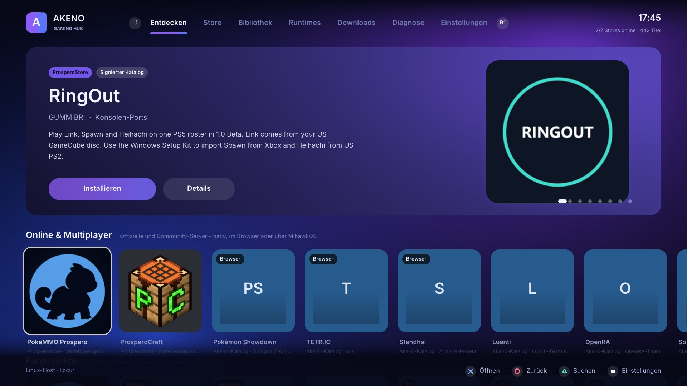

# Akeno Gaming Hub – PS5 Edition

**One Hub. Multiple Stores. Universal Gaming.**

Akeno ist eine eigenständige Gaming-Plattform für die PS5: ein Katalog aus mehreren Stores, Downloads
mit Prüfung, automatische Installation und Updates, eine Bibliothek, Hauptmenü-Kacheln pro Spiel und
**eingebaute Runtimes**. Spiele laufen in Akeno selbst: Akeno startet sich im Spielmodus neu, die
Runtime übernimmt Bild, Controller und Ton. Akeno öffnet dafür keine anderen Apps.

Eingebaut sind heute native PS5-Titel und RPG Maker 2000/2003 (EasyRPG Player). Windows, Linux, Java,
HTML5 und weitere Engines sind geplant; ihre Grundlage aus vorhandenen PS5-Projekten steht in
[docs/RUNTIME_RESEARCH.md](docs/RUNTIME_RESEARCH.md).



| Store | Was Akeno damit macht |
| --- | --- |
| [ProsperoStore](https://prosperostore.net) | Vollständiger, **Ed25519-signierter** Katalog (243 Apps): installieren, aktualisieren, entfernen |
| [RecompStore](https://www.recompstore.com) | Recompilations und Ports, installiert über GitHub-Releases mit veröffentlichtem SHA-256; „bring your own disc" wird angezeigt |
| Akeno-Katalog | 38 kuratierte kostenlose, Online- und Fanspiele (PokeMMO, Pokémon Showdown, PokéRogue, Luanti, OpenRA, SRB2 …) mit ehrlichem Status: nativ spielbar oder welche Akeno-Runtime noch fehlt |
| itch.io | RPG-Maker-2000/2003-Spiele über die offizielle API (eigener Schlüssel) installieren und in Akeno spielen; weitere Spiele zum Entdecken |
| Game Jolt | Indie-Spiele zum Entdecken |
| GOG, Epic Games | Kostenlose PC-Spiele und Gratis-Aktionen zum Entdecken; Kauf/Download über das eigene Konto |
| GitHub | Eigene Repositories mit PS5-Titel-ZIPs |

Status nach Stufen: [STATUS.md](STATUS.md). Kurz: Akeno **startet auf der PS5** und lädt die Kataloge
(Nutzertest); Downloads, Spielmodus und die eingebaute RPG-Maker-Runtime sind auf der Konsole noch
unbestätigt. Was aus dem Master-Prompt umgesetzt ist und was fehlt:
[docs/MASTER_PROMPT_COVERAGE.md](docs/MASTER_PROMPT_COVERAGE.md).

Neu in `01.004.000`: Spielmodus und die erste eingebaute Runtime (RPG Maker 2000/2003), itch.io-Downloads
über die offizielle API, Kacheln pro Spiel, keine Weiterleitungen an andere Apps.

## Schnellstart

PS5-Paket bauen (Linux/WSL, siehe [BUILD.md](BUILD.md)):

```sh
bash ps5/build.sh
```

`ps5/dist/PPSA90410.zip` installieren und testen: [INSTALLATION.md](INSTALLATION.md).

Auf dem Entwicklungsrechner dieselbe App starten:

```sh
make native-run
```

## Aufbau

| Pfad | Inhalt |
| --- | --- |
| `native/src/core` | JSON, SHA-256/Ed25519, Dateien, ZIP-Prüfung, Bilder |
| `native/src/stores` | Provider und Zusammenführung der Kataloge |
| `native/src/install` | Download-Manager, Installer, Bibliothek |
| `native/src/runtime` | Engine-Erkennung, Akeno-Runtimes, Starts nativer Titel, Kacheln |
| `native/src/play` | Akeno-Bibliothek, Startprofile, Spielmodus, eingebaute RPG-Maker-Runtime |
| `native/src/ui` | Oberfläche (SDL2) |
| `native/src/platform` | Host (Linux, libcurl) und PS5 (`sceHttp`, Pfade, Loader) |
| `ps5/` | PS5-Build: Toolchain, Titel-Runtime, SDL-Patches, Start-Payload, Kachel, `sce_sys` |
| `core/`, `stores/`, `apps/ps5-hub/web` | Python-Host-Hub (Web-UI, HTML5-Player) |

Weitere Dokumente: [Architektur](ARCHITECTURE.md) · [Stores](docs/STORES.md) ·
[Runtimes](docs/RUNTIMES.md) · [Recherche](RESEARCH.md) · [Audit](docs/AUDIT.md) ·
[Sicherheit](SECURITY.md) · [Bekannte Einschränkungen](KNOWN_ISSUES.md) · [Roadmap](ROADMAP.md)

## Rechtliches

Akeno-Code steht unter GPL-3.0-or-later ([LICENSE](LICENSE)); Drittkomponenten behalten ihre Lizenzen
([THIRD_PARTY_LICENSES.md](THIRD_PARTY_LICENSES.md)). Keine Sony-SDK-Dateien, Firmware, Schlüssel oder
geschützten Spieldaten. Recomps und Emulatoren benötigen eigene, rechtmäßig erstellte Dumps. Akeno
umgeht keine Kaufprüfungen oder Server-Autorisierungen. PlayStation und PS5 sind Marken von Sony
Interactive Entertainment; Akeno ist ein unabhängiges Projekt.
